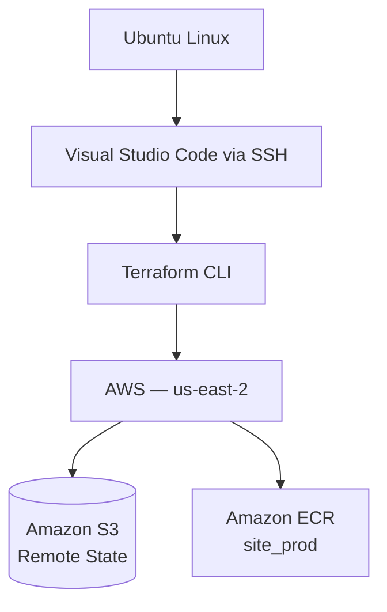

# Terraform AWS — Infrastructure as Code

[](https://developer.hashicorp.com/terraform)
[](https://aws.amazon.com/)
[](https://ubuntu.com/)

## Sobre o projeto

Este projeto tem como objetivo aplicar conceitos de **Infrastructure as Code (IaC)** utilizando Terraform para provisionar e gerenciar recursos na Amazon Web Services (AWS).

O ambiente de desenvolvimento foi configurado em uma máquina Ubuntu, acessada remotamente por SSH utilizando o Visual Studio Code. A infraestrutura é definida em arquivos Terraform e gerenciada por meio do Terraform CLI.

O projeto contempla a configuração do provider AWS, o armazenamento remoto do estado no Amazon S3 e a definição de um repositório privado no Amazon Elastic Container Registry (ECR).

## Arquitetura



*O diagrama apresenta os principais componentes configurados no projeto. A existência e o provisionamento de outros recursos dependem das definições presentes nos respectivos arquivos Terraform.*

## Recursos AWS

| Recurso | Configuração | Finalidade |
|---|---|---|
| AWS Provider | `us-east-2` | Define a região de provisionamento |
| Amazon S3 | `terraform-state-kaique` | Armazenamento remoto do estado |
| State Key | `site/terraform.tfstate` | Caminho do arquivo de estado |
| Amazon ECR | `site_prod` | Armazenamento de imagens de contêineres |
| Image Tag Mutability | `MUTABLE` | Permite reutilizar e atualizar tags de imagens |

## Estrutura do projeto

```text
lab02/
├── backend.tf
├── comandos.txt
├── ec2.tf
├── ecr.tf
├── provider.tf
└── evidência/
```

### Arquivos

- **`backend.tf`** — configuração do backend remoto no Amazon S3.
- **`provider.tf`** — configuração do provider AWS e da região `us-east-2`.
- **`ecr.tf`** — definição do repositório Amazon ECR `site_prod`.
- **`ec2.tf`** — arquivo destinado às definições de recursos EC2.
- **`comandos.txt`** — registro de comandos utilizados durante o laboratório.
- **`evidência/`** — diretório para armazenar capturas de tela e evidências da implementação.

## Ambiente de desenvolvimento

O Terraform foi instalado em um ambiente Ubuntu, acessado remotamente por SSH através do Visual Studio Code.

Essa abordagem permite editar os arquivos de infraestrutura e executar os comandos diretamente no ambiente Linux, mantendo o fluxo de trabalho centralizado no terminal integrado.

## Pré-requisitos

- Conta AWS ativa.
- Terraform instalado no Ubuntu.
- Credenciais AWS configuradas por um método seguro.
- Permissões IAM para os recursos utilizados.
- Bucket S3 previamente criado.
- Visual Studio Code com acesso SSH ao Ubuntu.

## Implementação

### 1. Inicialização

```bash
terraform init
```

Inicializa o diretório de trabalho, configura o backend e instala os providers necessários.

### 2. Formatação

```bash
terraform fmt
```

Padroniza a formatação dos arquivos Terraform.

### 3. Validação

```bash
terraform validate
```

Verifica a consistência sintática e estrutural da configuração.

### 4. Planejamento

```bash
terraform plan
```

Apresenta as alterações previstas antes de modificar os recursos da AWS.

### 5. Provisionamento

```bash
terraform apply
```

Aplica as alterações definidas nos arquivos Terraform após a revisão e confirmação do plano.

## Acesso remoto à instância EC2

Durante o laboratório, foi utilizado SSH para acessar uma instância EC2:

```bash
ssh -i chave-site-prd.pem ec2-user@18.225.223.98
```

O acesso depende da disponibilidade da chave privada, das permissões configuradas e das regras de rede da instância. A chave privada não deve ser enviada ao GitHub.

## Gerenciamento do estado remoto

O backend S3 permite armazenar o estado do Terraform remotamente, separando-o dos arquivos de configuração versionados no Git.

Configuração utilizada:

```hcl
terraform {
  backend "s3" {
    bucket  = "terraform-state-kaique"
    key     = "site/terraform.tfstate"
    region  = "us-east-2"
    encrypt = true
  }
}
```

O arquivo de estado pode conter informações sensíveis e não deve ser versionado no repositório.

## Limpeza dos recursos

Para visualizar as ações previstas para a destruição:

```bash
terraform plan -destroy
```

Para remover os recursos gerenciados pelo Terraform:

```bash
terraform destroy
```

> **Atenção:** revise o plano antes de confirmar a destruição. A operação pode excluir recursos reais e dados associados. Não remova o bucket que armazena o estado enquanto ele ainda for necessário.

## Segurança

- Não versionar chaves privadas, tokens ou credenciais AWS.
- Utilizar políticas IAM com privilégio mínimo.
- Manter o estado remoto protegido.
- Revisar `terraform plan` antes de aplicar alterações.
- Restringir o acesso SSH a endereços confiáveis.
- Não publicar informações sensíveis da infraestrutura.

## Competências praticadas

- Infrastructure as Code com Terraform.
- Provisionamento de recursos na AWS.
- Configuração de backend remoto no Amazon S3.
- Gerenciamento de repositórios de imagens com Amazon ECR.
- Administração de ambiente Ubuntu Linux.
- Acesso remoto via SSH e Visual Studio Code.
- Versionamento de código com Git e GitHub.
- Ciclo de vida de infraestrutura: inicialização, validação, planejamento, aplicação e destruição.

**Projeto desenvolvido para aplicar e aprofundar conhecimentos em Infraestrutura como Código (IaC), utilizando Terraform para provisionamento e gerenciamento de recursos na AWS. O projeto explora a automação da infraestrutura, a configuração de recursos em nuvem e o armazenamento remoto do estado do Terraform em um bucket S3, seguindo boas práticas de organização, versionamento e manutenção de código.**
